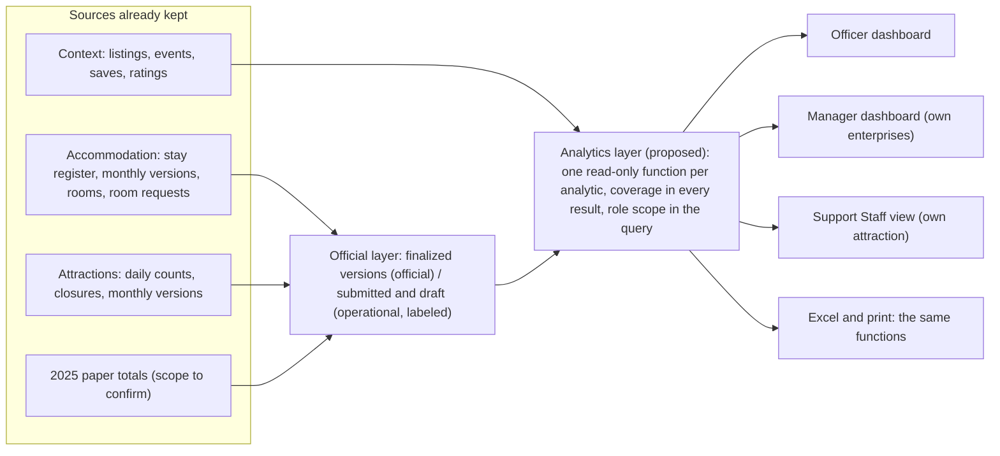

# Role-based dashboards and data flow

Proposal, 12 November 2026. The interactive mockup is `mockup.html` here and the published Artifact (the same file). IDs (A1, T3, X1…) refer to `02-analytics-inventory.md`; G-numbers to `04-prioritized-gaps.md`.

## 1. Principles

1. **Two domains, two panels.** Accommodation arrivals and attraction visits sit side by side on a shared month axis, each with its own scale and its own coverage. They are never summed, indexed together or called "tourists".
2. **Coverage beside every number.** Under each monthly chart a small band shows how many places finalized, submitted, are in draft or are missing. A partial month is hatched and left out of peak and low.
3. **Official by default.** Finalized figures are the default. An Operational switch adds submitted and draft months and says so.
4. **Counts first.** Shares and percentage change sit behind a switch that says "needs a decision".
5. **Every chart has a table** and an "About this analytic" block with its source, calculation, value, best chart and limits.

## 2. Tourism Officer

Scope: every place. Official and operational.

| Section | Analytics | What the officer learns |
|---|---|---|
| What live holds | facts from the database | What data exists, what does not |
| Municipal overview | A1, A2, A3, T1, X4 | How both domains move through the year, and how much is reported |
| Peak and low periods | A5, T2, T3, T4 | Busy and quiet months, days and weekdays |
| Comparison | A6, T5 | This month and year against the last, on comparable months only (after G4) |
| Residence and sex | A7, A8, T8, T9, X2 | Who comes, only where collected, with the unrecorded share visible |
| Barangay, category, location | A14, T6, T7 | Where the places and the counted visits are |
| Completeness and gaps | X1, X3, X5 | Who has not reported, which attractions are not counted |

Build first: A1, A2, A3, A5, T1, T2, T3, X1, X4 (build order 1).

## 3. Enterprise Manager

Scope: their own enterprises, switched from the header like the rest of the portal.

| Section | Analytics | Notes |
|---|---|---|
| This year | A1, A2, A3 | Own arrivals, nights, average stay |
| Occupancy | A4 | The DAE rate, with both counts in the tooltip |
| Guests | A7, A8 | Residence and sex of their own guests only |
| Pattern | A9, A10 | Arrivals by weekday, length of stay |
| Requests | A11, A12, A13 | The room-request funnel for ZTIMS bookings only |
| Reporting | X1 | Their own months: finalized, submitted, open |
| Against the municipality | benchmark | Shown only above a minimum group size (D-A5) |

A manager's own last-year line cannot exist before 2027: 2025 was reported as one paper total (G5). The prototype previews it with a switch.

## 4. Support Staff

Scope: their one attraction. Read views for planning and finishing the month; counts are entered on the Daily Visitor Record.

Daily visits with a 7-day average (T2), visits by weekday (T3), month progress and what is left to finish (X1), and last month's figure for comparison.

## 5. Not proposed

A public dashboard for visitors. The data is thin, partly unverified (G3, G9) and the audience was not asked for. It can follow once two full years exist.

## 6. Data flow

- **No new collection** is needed for the first version. The analytics read the monthly versions (the official layer), the stay register and daily counts (operational detail), and the listings.
- **One computation** serves the screens, the previews and the Excel files, as the reporting modules already do.
- **Computed on request** at first. A monthly snapshot table can be added later only if reads become slow. That would be a schema change and needs the usual approval path.
- **Rules in the layer:** server-side role and assignment checks; bounded queries (a year at most, grouped in the database); no per-guest rows; no credentials or personal data in results, errors or exports; a missing month is a gap, never 0.

## 7. Who sees what

| Role | Sees | Does not see |
|---|---|---|
| Tourism Officer | Every place, both domains, official and operational, completeness, gaps | Stay-level detail and guest data (D-A6) |
| Enterprise Manager | Own stays, versions, requests; a municipal comparison above the minimum group size | Other enterprises' figures |
| Support Staff | Own attraction's daily counts and weekday pattern | Other attractions, accommodation, money |
| Visitors and everyone else | Nothing here | Everything |

## 8. Suggested order of work (after review and the decisions)

1. The analytics layer for A1, A2, A3, T1, X1 and the coverage band, with the officer's overview. Needs the stage 4 and 5 rollout and the 2026 data (G1).
2. Peak and low (A5, T2, T3, T4) and the Support Staff and manager views.
3. Residence, sex, barangay and category (A7, A8, A14, T6 to T9) once the shares decision (G4) and the minimum group size (G15) are made.
4. Comparisons (A6, T5) when a second year exists.
5. Requests, events and interest signals (A11 to A13, T10, T11).
