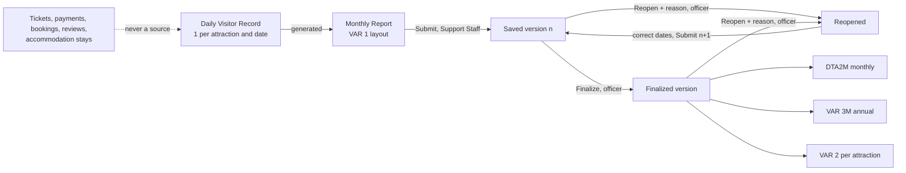

> Current scope (14 November 2026): entrance sales and officer collections are retired. Room payments remain. Admission-related descriptions below are historical, not current behavior. See MANUSCRIPT-NOTES.md and diagrams/entrance-removal-redraw-list.md.

# Attraction reporting: workflow, statuses and proposed data model

Proposal for review. No code or database is changed by this document.

## 1. The flow

Assigned attraction → **Daily Visitor Record** → automatically generated **Monthly Report** → **Submit** → officer **Finalize** or **Reopen** → municipal **DTA2M** (monthly) and **VAR 3M** (annual), with **VAR 2** as a per-attraction view.

One source of counts: the daily record. Monthly summaries, versions' figures, DTA2M, VAR 3M and VAR 2 are computed from it. Nothing is re-entered.

## 2. Roles

| Action | Support Staff (own attraction) | Tourism Officer | Enterprise Manager | Tourist |
|---|---|---|---|---|
| Record and edit daily counts | Yes, while the month is editable | No | No | No |
| Submit the month | Yes | No | No | No |
| View reports and history | Own attraction | All | No | No |
| Finalize | No | Yes | No | No |
| Reopen (reason of 10+ characters) | No | Yes | No | No |
| DTA2M, VAR 3M, VAR 2, Excel | No | Yes | No | No |
| Set closed dates (existing, Visitor setup) | No | Yes | No | No |

No officer recording screen, no silent monthly override, no approval or rejection queue.

## 3. Month statuses and transitions

| Status | Meaning | Recording | Next |
|---|---|---|---|
| Recording (In progress / Dates missing / Ready to submit) | Computed from the daily records. Not stored | Open | Submit when ready |
| Submitted v n | Saved immutable version, waiting for the officer | **Locked** | Finalize or Reopen |
| Finalized | The officer accepted version n. Official source | **Locked** | Reopen |
| Reopened | The officer reopened it with a reason | Open | Correct, then Submit version n+1 |
| Before reporting, Not yet, No Support Staff | Informational | n/a | n/a |

- **Ready to submit** means every date of a finished month is a recorded count (zero included) or an authorized closure. Weekly closed days are not assumed zero: the Support Staff confirms each one (a bulk "Confirm no visitors" action lists them, nothing pre-ticked).
- A saved version never changes. A correction is version n+1 with a reason and a computed list of changed dates.
- **Officially issued figures stay until replaced.** While a finalized month is reopened, the last finalized version remains the official source (marked "correction pending"). It is replaced only when the new version is finalized. Old and new versions are never both counted.
- Reopening or correcting marks the outputs built from that version as needing regeneration and supersedes them when the replacement is finalized. Earlier issued versions are kept.

## 4. Proposed data model (for the later build stage)

This is a proposal to be reviewed. Names are provisional.

**`attraction_daily_counts`** (the one authoritative source)
- `id`, `spot_id` → spots, `count_date` (date), unique `(spot_id, count_date)`.
- `total` integer not null, 0 to a sensible bound (for example 100,000). Presence of a row means a confirmed count, zero included. **No row = missing.**
- Residence (each nullable; null = unknown): `res_zamboanguita`, `res_negros_oriental_other`, `res_other_province`, `res_foreign`. Check: each ≥ 0, sum ≤ total.
- `residence_complete` boolean: true only when the sum equals the total. Null residence with the flag false means unknown, not zero.
- Sex: `male`, `female` (nullable), `sex_complete`. Check: male + female ≤ total, equality when complete. **No sex-by-residence columns.**
- `revision` integer (optimistic lock), `created_by_*`, `updated_by_*`, timestamps, `request_key` (idempotency, unique with spot and date) so a retried save does not duplicate.
- A confirmed zero requires all breakdowns empty or zero.

**`attraction_closures`**: authorized closures come from the existing closed-dates data (`spot_closed_dates`), read-only for Support Staff. No new editable closure source.

**`attraction_report_versions`**: `spot_id`, `year`, `month`, `version`, figures (computed copies for history only: total, dates counted, zero days, closed days, class totals, unclassified counts), `daily` snapshot (jsonb), `reason`, `submitted_by`, `submitted_at`, `source_digest`. Immutable (trigger). Unique `(spot_id, year, month, version)`.

**`attraction_period_events`**: `submitted`, `finalized`, `reopened` with version, reason, actor, time. Immutable. Reopen reason of 10 or more characters.

**`attraction_periods`**: current state per attraction and month (`finalized_at`, `finalized_version_id`, `locked`), updated only with the events.

**Triggers** (database-enforced, like the accommodation module): a daily count of a month that is submitted or finalized cannot be inserted, updated or deleted. A saved version cannot be updated or deleted. A month cannot be submitted incomplete.

**Concurrency:** every write takes a per-attraction transaction lock. A save names the `revision` it read (409 if stale). Submit and finalize name the latest version.

**Security of the model:** row-level security on with no policies, same as the other tables (only the API connection reads). The existing 72-row `residences` list and `monthly_report_counts` are not the attraction basis any more.

**Legacy:** `monthly_reports` rows of kind `attraction`, their country rows, `register_entries` for attractions and the 2025 `municipal_total` rows stay exactly as they are. They are read-only history and never mixed into the new outputs.

## 5. Statistics separation

- Attraction visits and accommodation arrivals and guest-nights are separate everywhere: routes, tiles, tables, charts, dashboard and Excel.
- No total adds attraction visits to accommodation. No total across attractions is described as tourists.
- The 2025 municipal totals stay under their existing label and are not allocated to attractions or relabeled as attraction-only.
- Output sources: **Official** = finalized versions. **Operational** = also submitted and draft, labeled. A month with no usable version shows "Not submitted", never 0.

## 6. Screens (see the mockup)

- Support Staff: **Daily Visitor Record** (date list, collapsible residence and sex sections, explicit zero, missing/closure states, save/failure/expired/conflict states) and **Monthly Reports** (generated VAR 1 preview, Submit, History).
- Officer, inside Statistics: Tracker → Attractions (review window with Finalize and Reopen) and **Attraction Visits** (DTA2M, VAR 3M, VAR 2, Official/Operational switch). No separate portal.
