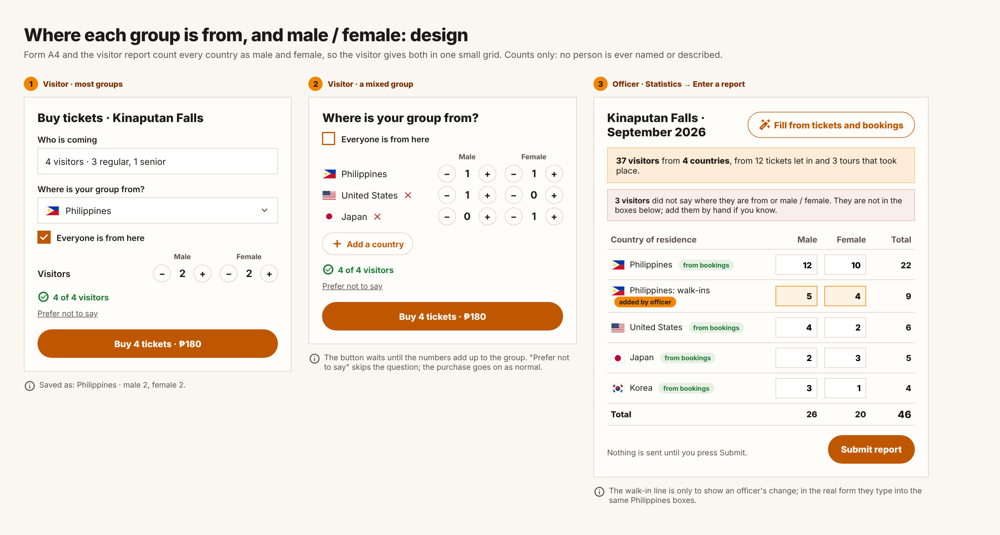
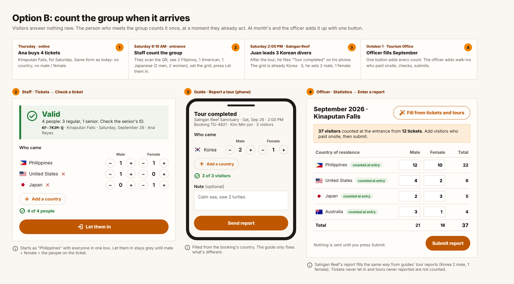

# Idea: where each group comes from (country, male / female)

**Status: idea only, nothing built (October 2026).** Held by the user; build
only when they say so.

## The problem

The monthly visitor report for an attraction (and Form A4 for accommodations)
counts visitors by **country of residence** and **male / female**. Today the
officer types these by hand. Tickets and guide bookings already pass through
ZTIMS, but they do not record the group's mix: a guide booking keeps one
country (the booker's, `guide_bookings.nationality`), a ticket keeps none, and
neither keeps male / female. Example: 4 visitors, 2 Filipino, 1 American,
1 Japanese — today nothing in ZTIMS can say that.

## Option A — the visitor answers when booking (not chosen)

"Where is your group from?" on the ticket and booking forms: one country with
Male / Female steppers, or several countries for a mixed group; the numbers
must add up to the group; "Prefer not to say" skips it. Weaknesses: slows
booking, many skip it, visitors who pay onsite never see it, and it counts
people who booked rather than people who came.

## Option B — count the group when it arrives (preferred)

Visitors answer nothing new. The person who meets the group counts it once,
at a moment they already act:

1. **Entrance (Tickets page).** After "Valid", a small "Who came" grid
   (country rows, Male / Female steppers, Add a country). It starts as
   Philippines with everyone in one box; **Let them in** stays disabled until
   male + female = the people on the ticket. The QR is not needed for this:
   it is only the existing way to find and check the ticket (typing the code
   works the same).
2. **Guided tours (guide's "Tour completed" report).** The same grid on the
   guide's phone, filled from the booking's country; the guide fixes what is
   different.
3. **Month end (Statistics → Enter a report).** **Fill from tickets and
   tours** adds up what staff and guides counted for that place and month and
   puts it in the report's boxes, with one line saying where it came from.
   Only tickets let in and tours reported count; cancelled, refunded or unused
   ones never do. The officer adds visitors who paid onsite, checks, submits.
   Nothing is ever submitted by itself.

## Visitors who pay onsite (no ticket, no QR)

1. **For now:** the officer adds them by hand at month end (as in the image).
2. **Later, if the office wants it:** a "Record a group" button on Tickets for
   walk-ins — staff set country and male / female, no code needed.

## Rules it would keep, and the one it would change

- Counts only: no name is ever linked to a country or a sex; no money, no
  percentages. Form A4 itself is not touched (attraction visitors are never
  part of it).
- Storage would be one small table of counts per ticket or booking
  (country, male, female), kept like the other counts after the one-year
  erasure of names.
- **Rule to change (needs the user's yes):** CLAUDE.md says statistics are
  "Nothing from bookings". It would become: *ZTIMS may suggest the figures
  from tickets let in and tours that took place; only the officer submits
  them.*

## Questions still open

1. Agree to the rule change above?
2. Country of **residence** (what Form A4 uses), not nationality?
3. Count tours at guide-only places too (suggested: yes)?
